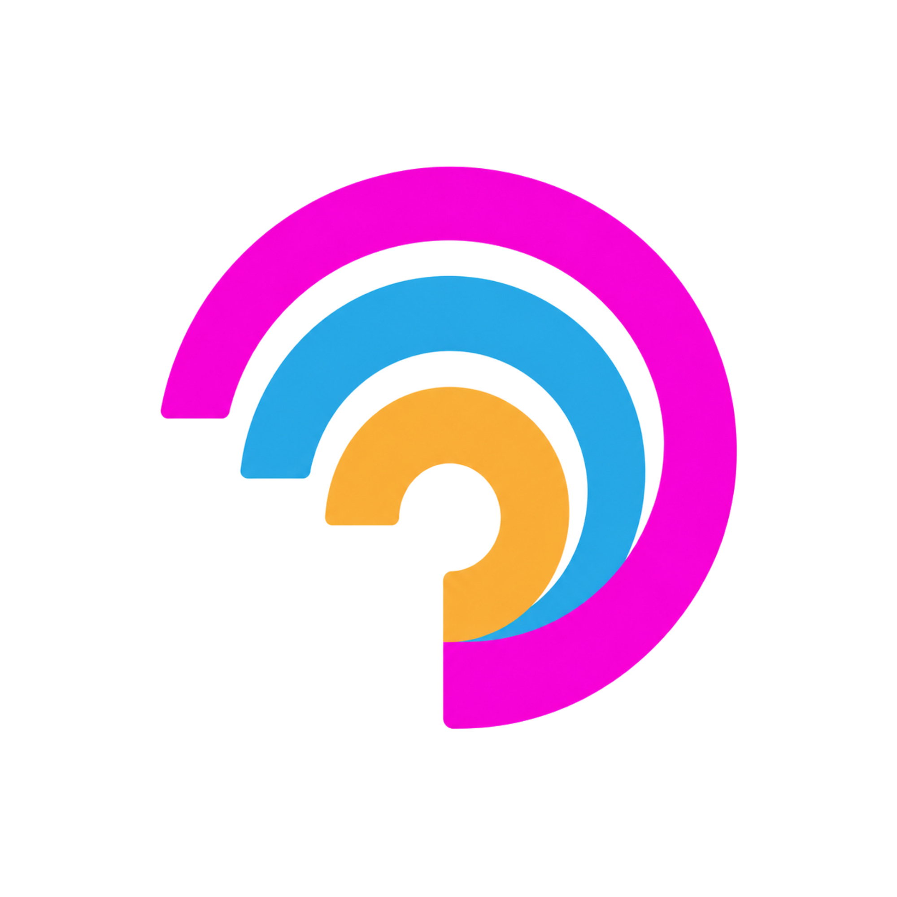

# Fernboard



Fernboard is a simple dashboard for organizing and accessing your favorite apps and tools in one place.

## What it does

- Centralizes your frequently used apps and tools
- Gives you a clean, modern dashboard experience
- Helps you quickly jump back into your work
- Built with Next.js for a fast and responsive web app

## Getting started

```bash
npm install
npm run dev
```

Then open http://localhost:3000 in your browser.

## Project status

This is a simple starter README for Fernboard. It will be expanded with more details, screenshots, and setup instructions later.
